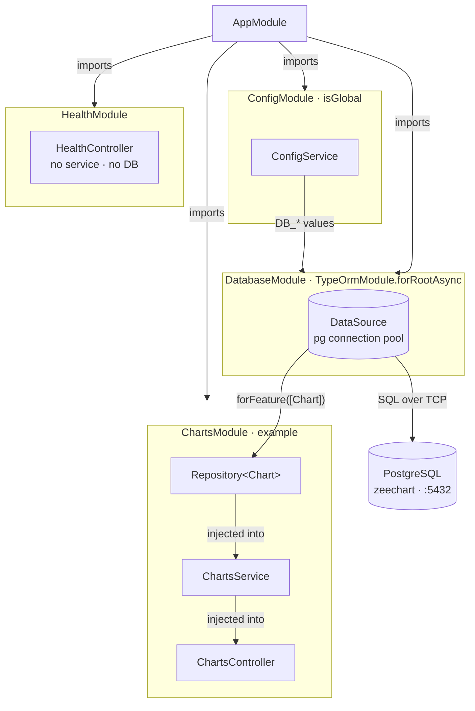
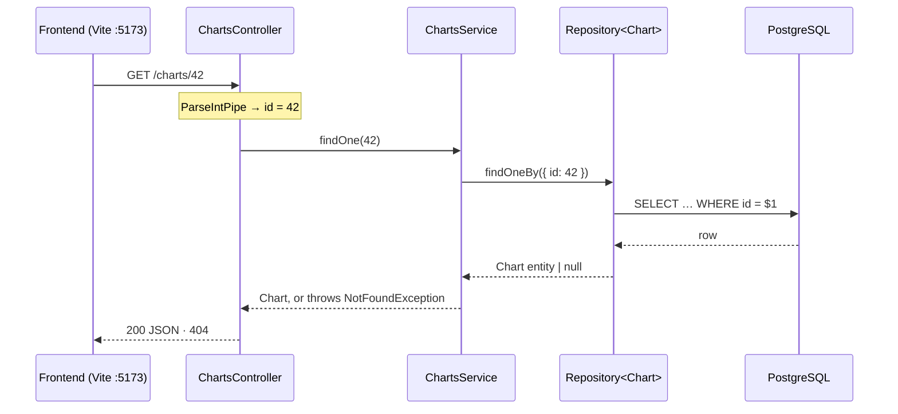

# Backend data flow: module → controller → service → DB

How the NestJS backend connects to PostgreSQL through TypeORM, and how a single
request moves from the frontend to the database and back.

> `ChartsModule` / `Chart` below are an **example feature** used to illustrate
> the pattern. They don't exist in the codebase yet.

## 1. Wiring at startup

Modules only wire things together; they hold no logic. `DatabaseModule` reads
the `DB_*` values from `ConfigService` and opens one shared `DataSource`
(connection pool). Each feature module asks for a repository scoped to its own
entity with `forFeature`, which Nest injects into the service, and the service
into the controller.

`DatabaseModule` also provides `RequestTransaction`. A write to a project
(`RevisionInterceptor`) is one transaction, on one connection: the project's
write lock (`ProjectWriteLock`), its changes and their history, saved together
or not at all. Services take their repositories from `RequestTransaction`
(`tx.repo(Entity)`), which hands out the write's transaction inside a write and
the shared `DataSource` elsewhere. Inside a write nothing may use the
`DataSource` directly: its query would run on a second connection, outside the
transaction, while the write holds the first (`test/one-connection.e2e-spec.ts`
runs every write with a pool of one connection to catch that).



## 2. One request, start to finish

Only the repository talks to Postgres. The controller turns HTTP into a plain
function call (and the result back into a response). The service decides what
"not found" means, and Nest turns what it throws (`notFound('Task')`, a `NotFoundException`) into a 404.



## Who does what

| Piece      | Does                                                                                                                   | Shouldn't                                                     | File                   |
| ---------- | ---------------------------------------------------------------------------------------------------------------------- | ------------------------------------------------------------- | ---------------------- |
| Module     | Declares which controllers, providers and imports belong together.                                                     | Contain logic.                                                | `charts.module.ts`     |
| Controller | Maps routes, parses params and body (DTOs, pipes), returns the response.                                               | Query the database or hold business rules.                    | `charts.controller.ts` |
| Service    | Business rules: lookups, checks, throwing `NotFoundException`, combining repositories.                                 | Know about HTTP requests or responses.                        | `charts.service.ts`    |
| Repository | Typed queries for one entity, provided by TypeORM.                                                                     | Be written by hand for simple CRUD.                           | injected, no file      |
| Entity     | Maps a class to a table and its columns.                                                                               | Change the schema without a migration (`synchronize` is off). | `chart.entity.ts`      |
| DataSource | One shared connection pool for the whole app (size: `DB_POOL_SIZE`). Inside a write, use `RequestTransaction` instead. | Be created per feature.                                       | `database.module.ts`   |

## The example feature in code

`src/charts/chart.entity.ts`

```ts
@Entity('charts')
export class Chart {
  @PrimaryGeneratedColumn()
  id: number;

  @Column()
  title: string;

  @CreateDateColumn()
  createdAt: Date;
}
```

`src/charts/charts.module.ts`

```ts
@Module({
  // gives this module Repository<Chart>
  imports: [TypeOrmModule.forFeature([Chart])],
  controllers: [ChartsController],
  providers: [ChartsService],
})
export class ChartsModule {}
```

`src/charts/charts.service.ts`

```ts
@Injectable()
export class ChartsService {
  constructor(
    @InjectRepository(Chart)
    private readonly charts: Repository<Chart>,
  ) {}

  async findOne(id: number): Promise<Chart> {
    const chart = await this.charts.findOneBy({ id });
    if (!chart) throw new NotFoundException();
    return chart;
  }
}
```

`src/charts/charts.controller.ts`

```ts
@Controller('charts')
export class ChartsController {
  constructor(private readonly charts: ChartsService) {}

  @Get(':id')
  findOne(@Param('id', ParseIntPipe) id: number) {
    return this.charts.findOne(id);
  }
}
```

Then register `ChartsModule` in `AppModule.imports`, and create the table with a
migration:

```sh
npm run migration:generate -- src/database/migrations/AddCharts
npm run migration:run
```
